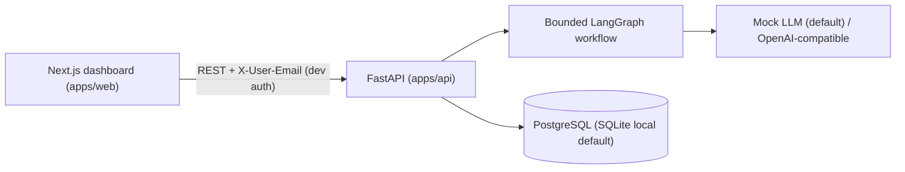

# Pamtengo: AI-Powered Sales Intelligence and Agent Platform

Pamtengo helps a business manage sales leads and use a **bounded, auditable AI agent** to qualify
them and draft **evidence-backed** outreach. Built as a portfolio project for an AI/software
engineering role, it prioritizes working software, sound architecture, tests, and honest
documentation over superficial features.

## What it does

1. Manage companies and sales leads (CRUD, search, filter).
2. Import leads from CSV with validation, duplicate handling, and prompt-injection flagging.
3. Score every lead against a configurable Ideal Customer Profile with a **deterministic,
   explainable 0-100 fit score** (never presented as a conversion probability).
4. Run a **LangGraph agent workflow** (mock LLM by default) that qualifies the lead, drafts a
   personalized email citing only available evidence, and records a full step-by-step trace.
5. Review, edit, approve, or reject drafts; **mock-send only after explicit human approval** with
   idempotency protection. No real emails are ever sent in the MVP.

## Architecture



See `docs/architecture.md`, `docs/agent-workflow.md`, `docs/threat-model.md`, `docs/evaluation.md`.

## Technology stack

- **Backend:** Python 3.11+ (3.12 compatible), FastAPI, Pydantic v2, SQLAlchemy 2.x, Alembic,
  pytest + HTTPX, Ruff. PostgreSQL via `DATABASE_URL`, SQLite default for zero-setup local runs.
- **Frontend:** Next.js 14 + TypeScript, React 18, Tailwind CSS, Recharts, Vitest.
- **AI:** LangGraph explicit workflow, provider abstraction (`mock` | `openai_compatible`),
  Pydantic-structured outputs, deterministic mock for tests/dev.
- **Infra:** Docker Compose, GitHub Actions CI, env-based config.

## Quickstart (local, mock AI)

Requirements: Python 3.11+, Node 22+, no API keys, no Docker needed for the default path.

```bash
# 1. Backend
cd apps/api
pip install -e ".[dev]"
cp ../../.env.example .env          # or set DATABASE_URL yourself
alembic upgrade head                # create tables
python ../../scripts/seed_demo.py   # fictional demo leads
uvicorn app.main:app --reload       # http://localhost:8000 (docs at /docs)

# 2. Frontend (second terminal)
cd apps/web
npm install
npm run dev                         # http://localhost:3000
```

With Docker (PostgreSQL + both services):

```bash
cp .env.example .env
docker compose up --build
```

## Environment variables

| Name | Default | Purpose |
|---|---|---|
| `DATABASE_URL` | `sqlite:///./pamtengo.db` | SQLAlchemy URL (use `postgresql+psycopg://…` for Postgres) |
| `CORS_ORIGINS` | `http://localhost:3000` | Allowed frontend origins |
| `AI_PROVIDER` | `mock` | `mock` or `openai_compatible` |
| `AI_TIMEOUT_SECONDS` / `AI_MAX_RETRIES` / `AI_MAX_TOKENS` | `20` / `2` / `2000` | Agent safety budgets |
| `OPENAI_API_KEY` / `OPENAI_BASE_URL` / `OPENAI_MODEL` | empty | Live provider (optional) |
| `SEED_ADMIN_EMAIL` | `admin@pamtengo.demo` | Default dev approver identity |
| `CSV_MAX_BYTES` / `CSV_MAX_ROWS` | `1048576` / `1000` | Upload limits |
| `NEXT_PUBLIC_API_URL` | `http://localhost:8000` | API base for the web app |

Every mutating demo request should send `X-User-Email: admin@pamtengo.demo` (the frontend does
this automatically). This is **development-only auth**. See `docs/threat-model.md`.

## Database migrations

```bash
cd apps/api
alembic upgrade head     # apply
alembic downgrade -1     # roll back one step
```

## Tests, lint, typecheck, build

```bash
cd apps/api && python -m pytest -q        # 18 tests, mocked LLM, no keys needed
cd apps/api && ruff check . && ruff format --check .
cd apps/web && npm test                   # 5 vitest tests
cd apps/web && npm run typecheck && npm run build
```

## Mock AI mode

Default (`AI_PROVIDER=mock`): the workflow uses deterministic templates with no network calls
and no API key, suitable for CI and demos. The Settings page shows which mode is active.
To try a live model:

```bash
AI_PROVIDER=openai_compatible OPENAI_API_KEY=sk-... uvicorn app.main:app
```

## Example API usage

```bash
H="X-User-Email: admin@pamtengo.demo"
curl localhost:8000/health
curl -X POST localhost:8000/api/v1/companies -H 'Content-Type: application/json' \
  -d '{"name":"Lilongwe Foods (demo)","country":"Malawi","industry":"agriculture","employee_range":"51-200"}'
# → {"id":"...","name":"Lilongwe Foods (demo)",...}
curl -X POST localhost:8000/api/v1/leads -H 'Content-Type: application/json' \
  -d '{"company_id":"<id>","full_name":"Chikondi Banda","job_title":"Director","email":"c@example.com"}'
curl -X POST localhost:8000/api/v1/leads/<lead_id>/qualify
# → {"id":"<run>","status":"completed","output":{"qualification":{"score":87,...},"draft_id":"..."}}
curl localhost:8000/api/v1/agent-runs/<run>/steps
curl -X POST localhost:8000/api/v1/outreach-drafts/<draft>/approve -H "$H"
curl -X POST localhost:8000/api/v1/outreach-drafts/<draft>/simulate-send -H "$H" \
  -H 'Content-Type: application/json' -d '{"confirm":true,"idempotency_key":"demo-1"}'
curl localhost:8000/api/v1/analytics/overview
```

Qualify response (abridged):

```json
{
  "status": "completed",
  "output": {
    "qualification": {
      "score": 87,
      "breakdown": [{"criterion": "industry_relevance", "points": 25.0, "outcome": "matched", "evidence": ["company.industry=agriculture"]}],
      "missing_info": [],
      "llm_summary": "Chikondi Banda at Lilongwe Foods … scored 87/100 (rule-based fit, not a conversion probability)…"
    },
    "draft_id": "…",
    "claim_issues": []
  }
}
```

## Agent workflow & safety design

- Fixed six-node LangGraph workflow; allowlisted DB reads only; no shell/filesystem/network tools.
- Deterministic scoring is authoritative; the LLM only explains it in prose.
- Claims are scanned against a blocklist (website-research, prior-contact, unfounded achievements);
   flagged drafts stay editable `draft`s with warnings. They are never auto-sent.
- Timeouts, retry caps, and token budgets are configurable; failures persist with error messages and
  per-step durations for investigation.
- Imported CSV text is treated as untrusted data; injection-like content is flagged, never executed.

## Screenshots

Run both services, seed the demo data, then capture: Overview (`/`), Leads (`/leads`), Lead detail
(`/leads/[id]`), Agent run (`/runs/[id]`), Outreach review (`/outreach`), Settings (`/settings`).
Save under `docs/screenshots/` (git-ignored until you add real captures; no placeholders are
committed).

## Current limitations & next steps

- Dev-only auth (replace with OIDC/JWT + roles); single workspace, no multi-tenancy.
- In-memory rate limiting (needs Redis/ingress in production); SQLite default (Postgres via Compose).
- Live LLM path implemented but verified only in mock mode here; needs a keyed evaluation run.
- Next: human-rated draft quality set, adversarial CSV regression suite, per-step latency tracking,
  real email provider behind the same approval gate.

## Repository layout

```
apps/api/{app/{api,core,db,models,schemas,services,agents},alembic,tests}  backend
apps/web/{app,components,lib,tests}                                       frontend
data/demo/leads.csv          fictional import sample   scripts/seed_demo.py
docs/{architecture,agent-workflow,threat-model,evaluation}.md
docker-compose.yml  .env.example  Makefile  .github/workflows/ci.yml
```
