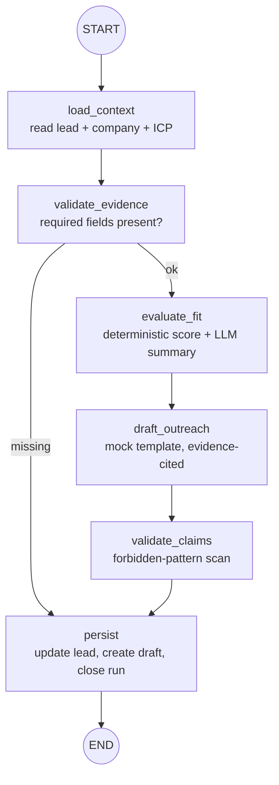

# Agent workflow

## Graph

The graph is declared with LangGraph (`build_graph()`) and executed node-by-node with the request's
DB session so every transition produces an inspectable `AgentStep` row.

## Node contract

| Node | Reads | Writes | Failure mode |
|---|---|---|---|
| load_context | lead, company, latest ICP | `context` | run failed: "Lead not found" / "Company record missing" |
| validate_evidence | context | `evidence_ok`, `missing` | sets `failed`, still persists the failure |
| evaluate_fit | context, ICP | `qualification` (score + breakdown + `llm_summary`) | retry limit, then run failed (timeout persisted) |
| draft_outreach | context, qualification evidence | `draft` (subject/body/evidence) | `AI_MAX_RETRIES` attempts, then run failed |
| validate_claims | draft | `claim_issues` | unsafe drafts kept as `draft` with warnings, never auto-sent |
| persist | everything | lead + draft + run rows | terminal; run is `completed` or `failed` |

## Safety rails

- **Timeouts:** every provider call wrapped in `asyncio.wait_for(AI_TIMEOUT_SECONDS)`.
- **Retries:** bounded by `AI_MAX_RETRIES` (default 2); no unbounded loops.
- **Token budget:** `AI_MAX_TOKENS` caps context sent to live providers.
- **Structured output:** `StructuredQualification` / `DraftOutput` Pydantic models; malformed model
  output raises `ProviderMalformedError` and fails the run visibly.
- **Claim validation:** regex blocklist rejects website-research claims ("I visited your website"),
  prior-contact claims ("as we discussed"), and achievement claims without evidence. Flagged drafts
  keep a `claim-warning:` evidence entry for the reviewer.
- **No autonomous sends:** the workflow has no path to the email provider at all. Sending is a
  separate human-authenticated endpoint.
