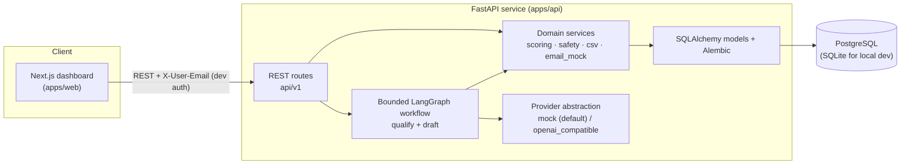

# Architecture

## System overview

## Key design choices

1. **Deterministic scoring baseline.** `score_lead()` in `app/services/scoring.py` applies fixed
   weights (industry 25, country 20, size 15, ICP/seniority 20, evidence completeness 20). The LLM
   writes the human-readable summary only; it never sets the number. This makes scores reproducible,
   testable, and explainable — an LLM-generated number would vary run to run and must never be
   presented as a conversion probability.
2. **Bounded agent, not an open agent.** The workflow is a fixed LangGraph `StateGraph`
   (load → validate → fit → draft → claim-check → persist) with allowlisted DB reads only. No shell,
   filesystem, network, or arbitrary tool access. See `docs/agent-workflow.md`.
3. **Human approval gate.** Drafts are `draft → approved → sent`. Approval identity comes from the
   server-side auth header (clients cannot set `approved_by`). Sends require `{"confirm": true}` and
   are idempotent via `idempotency_key`. The email provider is a mock that only records sends.
4. **Untrusted imports.** CSV content is data, never instructions. Prompt-injection markers in
   descriptions raise a `security_flag` activity and are passed to the model only as quoted data.
5. **Portable persistence.** UUID hex primary keys, UTC timestamps, Alembic migrations. SQLite is the
   zero-dependency local default; PostgreSQL via `DATABASE_URL` for shared/dev-server use.

## Request lifecycle (qualify)

`POST /api/v1/leads/{id}/qualify` → create `AgentRun(status=running)` → run the six nodes inline
(mock provider ≈ ms) → each node writes an `AgentStep` with `duration_ms` → `persist` updates the
lead (`fit_score`, `fit_explanation`, status) and creates an `OutreachDraft(status=draft)` →
`AgentRun(status=completed|failed)` with structured `output` or `error_message`. Every mutation also
writes an `Activity` row for the lead timeline.
